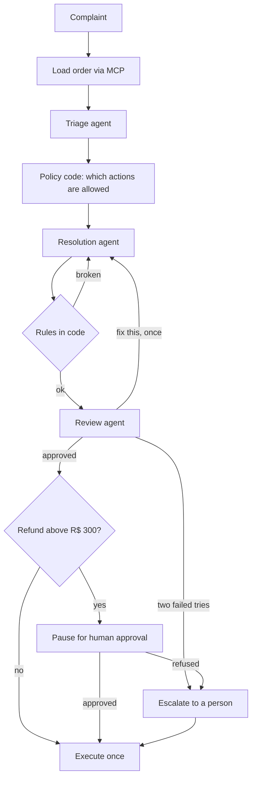

# Post-sale agent

Three AI agents and one person resolve "my order is late" for a store. Agents classify, propose and review, while plain code holds the rules, and refunds above R$ 300 wait for a human. Every decision is on screen, with who made it and why.

Project 8 of a 12-project AI engineering track focused on front-end. Orders come from [project 7's MCP server](https://github.com/Flaviohorbach/mcp-ecommerce-server). The interface is in Portuguese. All people and orders are fake, and no action is real.

**[Live demo](https://post-sale-agent.vercel.app)**

## How a case runs



## The model proposes, the code decides

A complaint is text written by a stranger, and text can talk a model into anything. So no rule that matters lives in a prompt:

- **Allowed actions come from code.** The schema of the agent's final tool only lists the actions policy allows for this order, so a forbidden one cannot be expressed.
- **The refund amount comes from the order.** The model has no field for it.
- **Evidence is checked.** Reshipping requires real `check_inventory` results for every item, read from the tool's output and not from what the model says.
- **Amounts in the message must exist in the order,** and a message cannot claim a refund unless that is the action.
- **Two tries, then a person.** Neither agent can loop forever or force an answer through.

## Does it work?

12 of 12 complaints pass ([cases](eval/cases.json), [answers](eval/results.json)), with real models and the live MCP server, at an average of **3.7 model calls per case**. Fixed rules check the action, whether the case paused and what the message says. The cases were written before the first run, and they include two prompt injections and a customer demanding R$ 5,000.

**The score hides what reading the answers shows:**

- **The first run invented a fact.** Asked about another color, the agent said the frying pan does not come in other colors, with no data on colors. The rules could not see it, and the reviewer approved it. It still scored as a pass, because no rule looked for that. I added an instruction and a rule for this case and reran only it, so the 12 of 12 includes one fix made after seeing the result.
- **The reviewer did not earn its cost in this run.** It sent back 1 proposal in 12, and that one was arguably wrong: a customer who said "no rush" got escalated, at 2 extra model calls. It also approved the invented fact. The rules in code barred nothing either. One run is thin evidence, but the honest next step would be to measure the pipeline without the reviewer.
- **Small promises slip through.** One message promises a new tracking code soon, and another says a canceled order was "not processed". Neither comes from the data.

A refund above the limit shows the customer's message before approval, already written as done. It is only sent if a person approves. A refusal replaces it with a message from code.

## Built for failure

- **Pausing survives anything.** A paused case lives in Postgres, so approval can arrive days later on another server instance. [A test](tests/persistence.test.ts) proves it with two instances that share only a database, using the production checkpointer over the real Postgres protocol.
- **Retries continue, not restart.** If the free model quota runs out mid-case, the case resumes from its last checkpoint, and the model calls that worked are not spent again.
- **Actions happen once.** A database key allows one record per case and action, and an atomic status change lets only one of two clicks resume a case.
- **Nothing before the pause has side effects,** because LangGraph runs the node again on resume.

## Decisions

- **LangGraph for orchestration, AI SDK for models.** LangGraph brings checkpoints, pauses and retries. The AI SDK keeps the fallback chain of models from earlier projects, which the free tier needs.
- **Most steps are not agents.** Loading the order, calculating lateness and executing are plain code. The screen shows how many model calls each step spent, and most spend none.
- **Least privilege per agent.** Triage and review have no tools. Resolution gets read-only store tools, and only when reshipping is possible, since that is the only decision needing them.
- **Live record, durable state.** Each step streams to the screen as one JSON line and is also saved, so closing the tab loses the view but not the case.

## Limits

- **No real actions.** They are only recorded. Real payments would also need an idempotency key at the provider.
- **Whoever has the link approves.** Production would need login and an approver role.
- **One message per case,** with no conversation history.
- **Fixed store date.** The simulated store is a snapshot, so "today" is fixed too.
- **Simplified policy.** For example, refunds are always for the full amount.
- **Free model quota.** A case spends several model calls, so the demo caps cases per day and offers recorded runs.

## Run it

Requires Node 22 or later and a free [Gemini API key](https://aistudio.google.com/apikey). No database setup is needed locally.

```bash
npm install
cp .env.example .env.local   # add GEMINI_API_KEY
npm run dev
```

```bash
npm test       # fake agents, the real graph, the published MCP package and a real Postgres protocol
npm run eval   # real models on 12 complaints, spends quota
```

## Built with AI

Written with a coding agent. [`docs/AI-LOG.md`](docs/AI-LOG.md) records what it got wrong, and [`docs/CONCEITOS.md`](docs/CONCEITOS.md) is a study guide in Portuguese.

## License

MIT.
